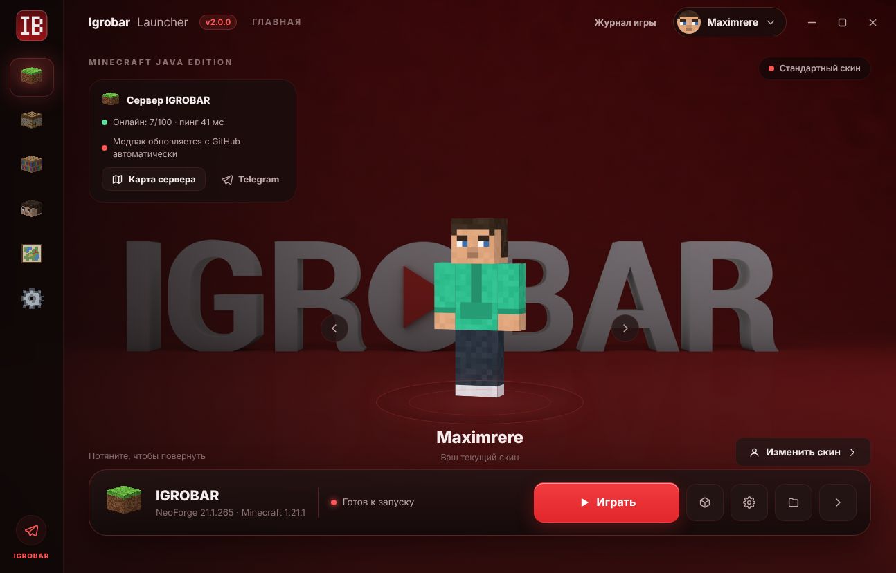
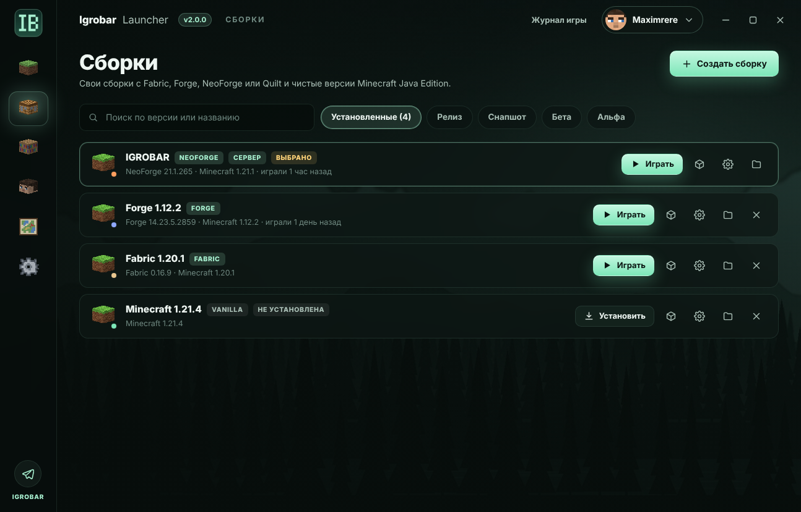
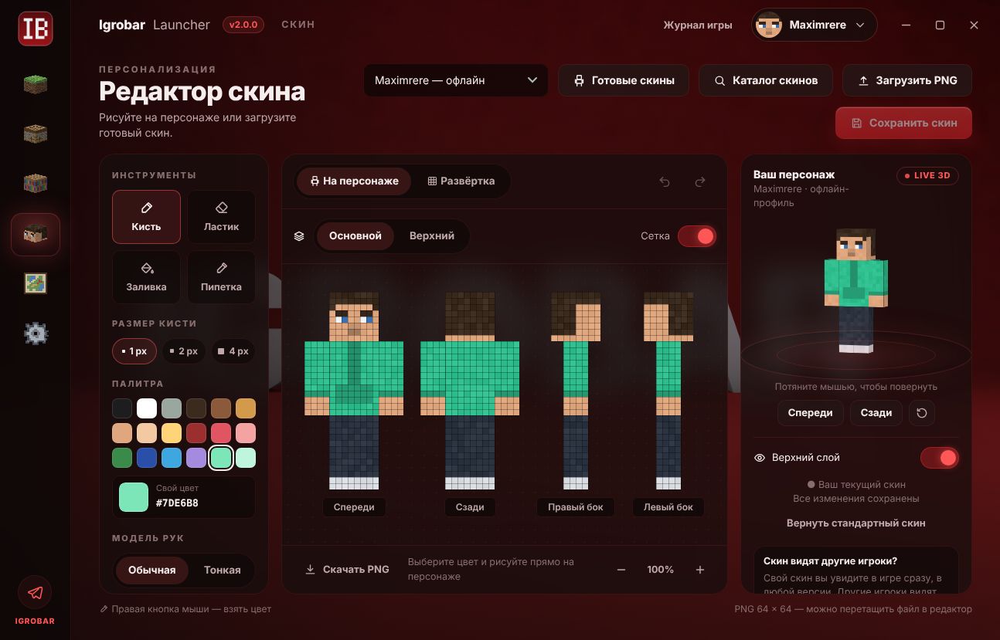
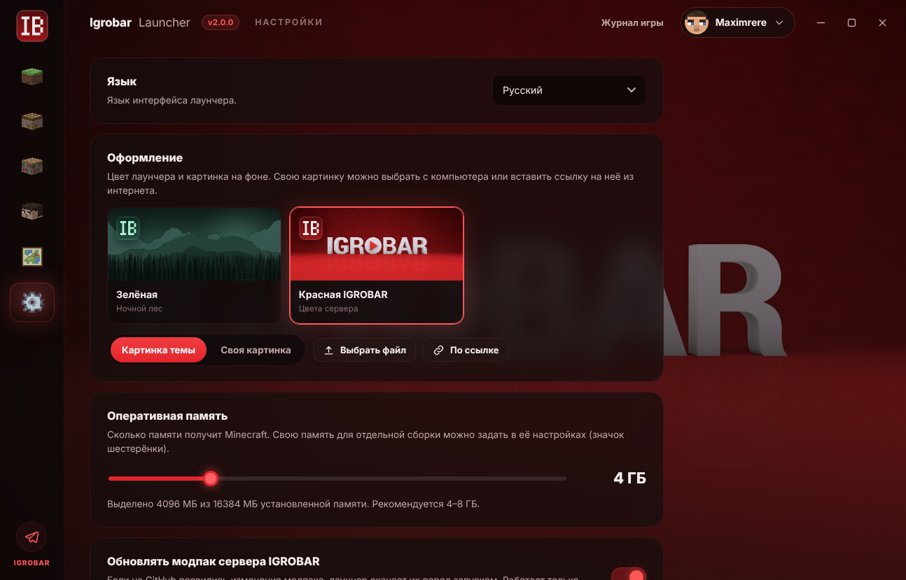
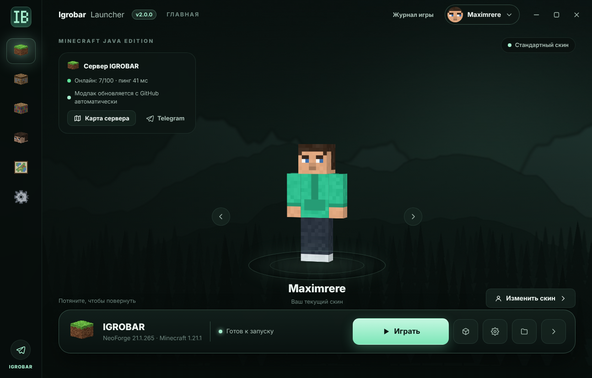

  

<h1 align="center">Igrobar Launcher</h1>

  <b>Лаунчер Minecraft для сервера IGROBAR — и для любых своих сборок.</b> 
  Один клик до сервера, моды с Modrinth, свой скин в игре без лицензии.

  
  
  
  

  

---

## ⚡ Сервер IGROBAR в один клик

Нажал «Играть» — и ты на сервере. Лаунчер сам ставит нужную версию Minecraft и NeoForge,
скачивает модпак сервера и добавляет IGROBAR в список «Сетевая игра» — адрес вводить не нужно.

- **Модпак обновляется сам.** Вышли новые моды на сервере — лаунчер подтянет их перед запуском.
  Свои моды игрока при этом не трогаются, а выключенные остаются выключенными.
- **Онлайн сервера на главной** — сколько игроков сейчас в игре и какой пинг.
- **Карта сервера** (DynMap) прямо в лаунчере и быстрый переход в Telegram.
- **Всегда актуальная версия.** Сервер переехал на новую версию Minecraft — сборка у игроков
  перестроится сама, обновлять лаунчер не нужно.

## 🧱 Любые версии и сборки

- Все версии Minecraft Java: **релизы, снапшоты, бета и альфа**.
- Загрузчики **Forge, NeoForge, Fabric, Quilt** — версия подставляется с пометкой «рекомендуется».
- У каждой сборки **своя папка** с понятным именем (`Forge-1.12.2`, `Fabric-1.20.1`) — свои моды,
  миры, ресурспаки и настройки. Общие файлы игры качаются один раз на все сборки.
- Своя память, аргументы Java, размер окна и полный экран — для каждой сборки отдельно.

## 🧩 Моды, ресурспаки и шейдеры

- Встроенный **каталог Modrinth** с поиском и категориями — установка в один клик, с зависимостями.
- **«Обновить все»** и **«Исправить»**, пометки «не хватает зависимостей» и «не для этой сборки».
- Просто **перетащи файлы** в окно — они окажутся в нужной папке.

## 🎨 Скины — как в лицензии, но без неё

- **Свой скин виден в игре сразу** — в любой версии, в одиночной игре и на серверах, без модов.
- **Редактор скина**: кисть, ластик, заливка, пипетка, рисование прямо на персонаже или на развёртке,
  два слоя, отмена и живой 3D-предпросмотр.
- **Каталог скинов** — сотни тысяч скинов с MinecraftSkins.com, Ely.by и NameMC: нажал «Скачать» на сайте,
  и скин уже в лаунчере.
- **Готовые скины** — выбрать персонажа в один клик.
- Скины других игроков подтягиваются с Ely.by, TLauncher и Mojang.

## 👤 Аккаунты

- **Офлайн-ник** — играть без лицензии.
- **Microsoft** — лицензия Minecraft, скин сразу загружается в профиль.
- **Ely.by** — бесплатный аккаунт со скинами, которые видят все.
- Несколько профилей и быстрое переключение; токены хранятся зашифрованными.

## ☕ Java не нужна

Лаунчер сам скачивает правильную Java под каждую версию игры: Java 8 для 1.12.2 и старых версий,
Java 17 и 21 — для новых. Ничего ставить отдельно не придётся.

## 🖌️ Оформление под себя

- Две темы: **зелёная** «Ночной лес» и **красная IGROBAR**.
- **Своя картинка на фон** — с компьютера или по ссылке из интернета, с регулировкой затемнения.
- Интерфейс на **русском, украинском и английском**.

## 🛡️ Надёжно

- **Докачка после обрыва** и повторные попытки — уже скачанное не теряется, установка не зависает.
- Проверка контрольных сумм модпака: моды меняются, только если всё скачалось целиком.
- **Журнал игры** в отдельном окне и кнопка «Скопировать отчёт», если игра упала.
- Пока идёт игра, лаунчер прячется в трей и возвращается, когда игра закрыта.
- **Лаунчер обновляется сам** — новая версия ставится при перезапуске.

---

  

  Сделано для сервера <b>IGROBAR</b> · <a href="https://t.me/igrobar">Telegram</a> ·
  <a href="https://igrobar.dynmap.xyz/">Карта сервера</a> 
  Для разработчика: <a href="docs/MAINTAINING.md">docs/MAINTAINING.md</a> · Что нового: <a href="RELEASE_NOTES.md">RELEASE_NOTES.md</a>

