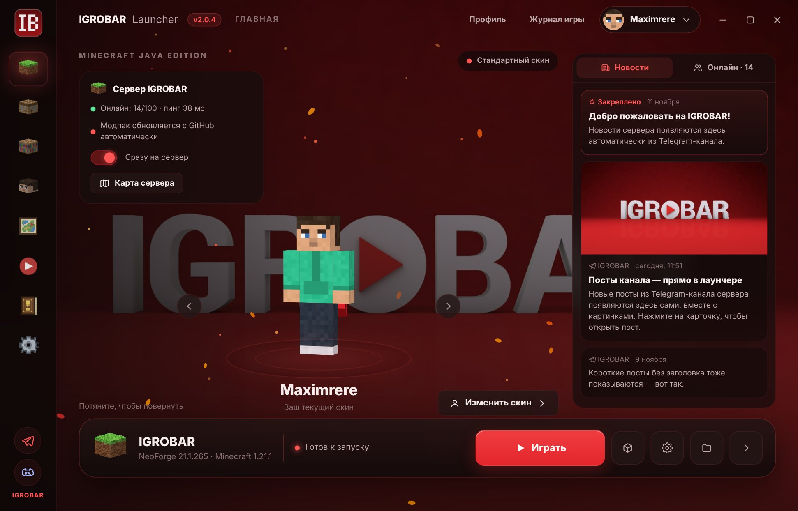
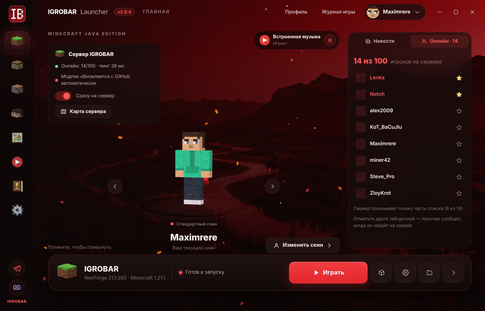
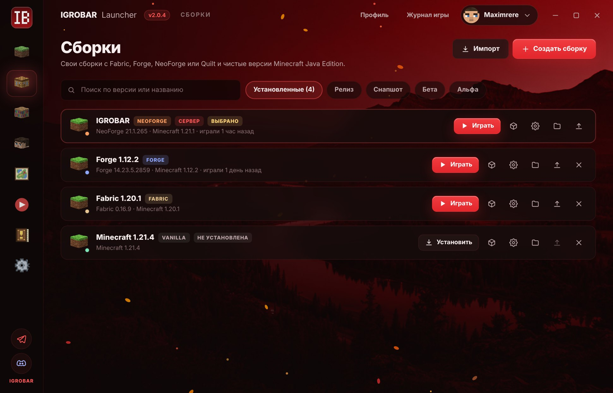
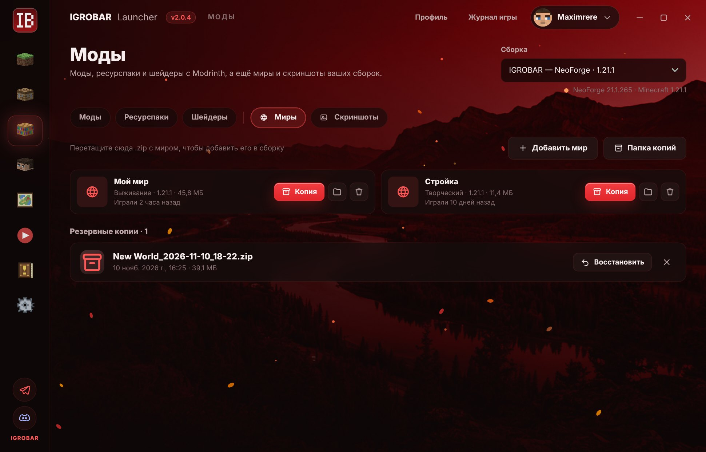
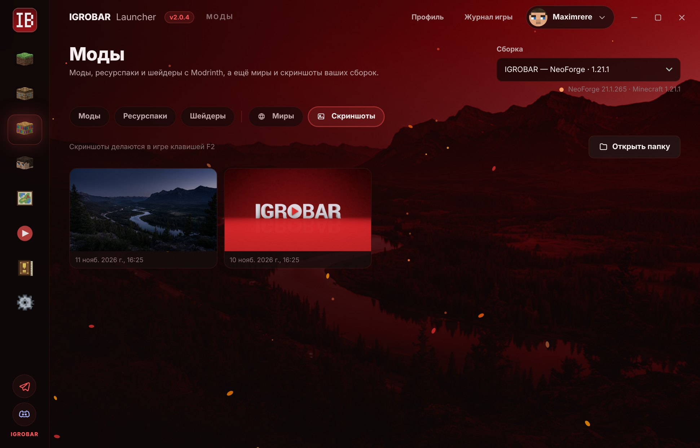
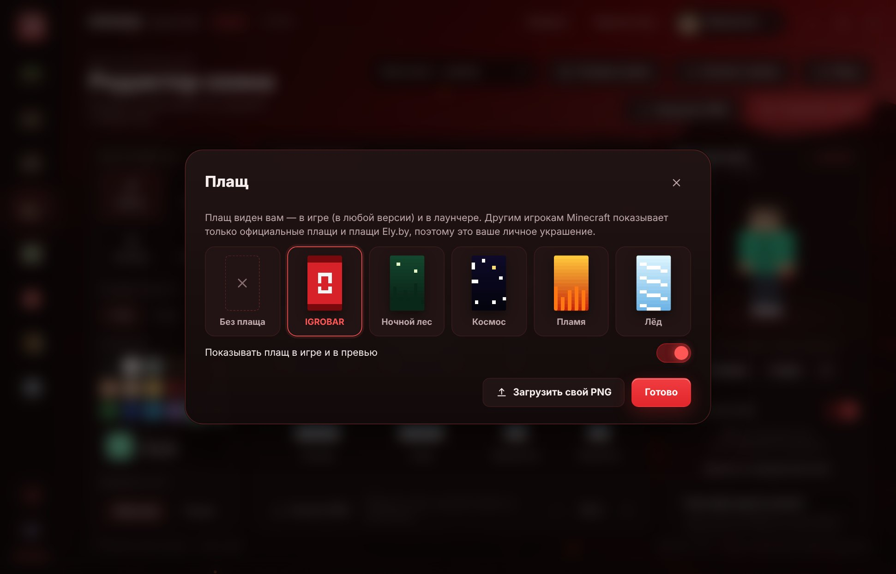
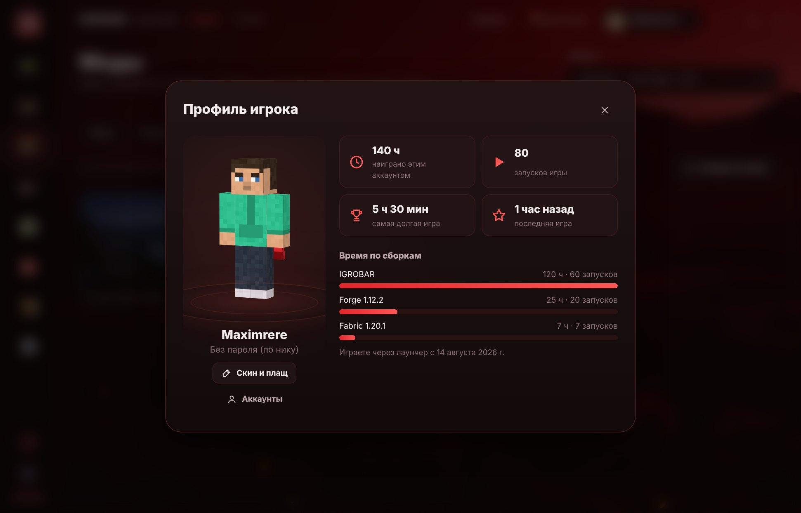
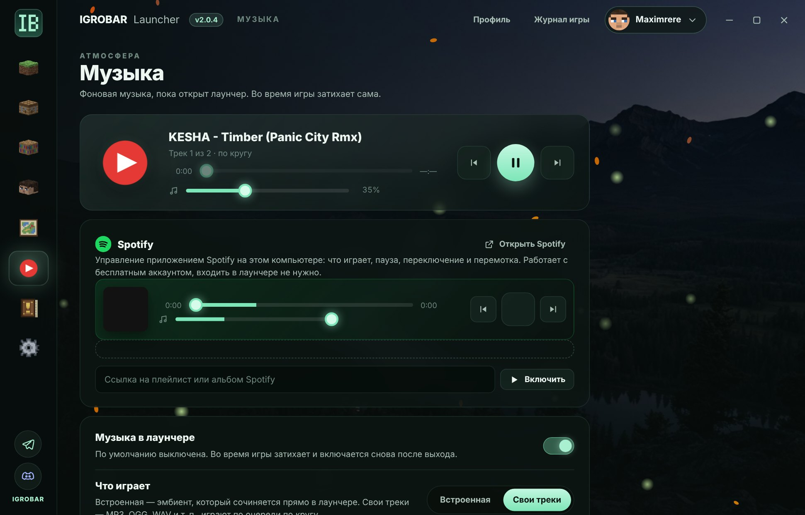
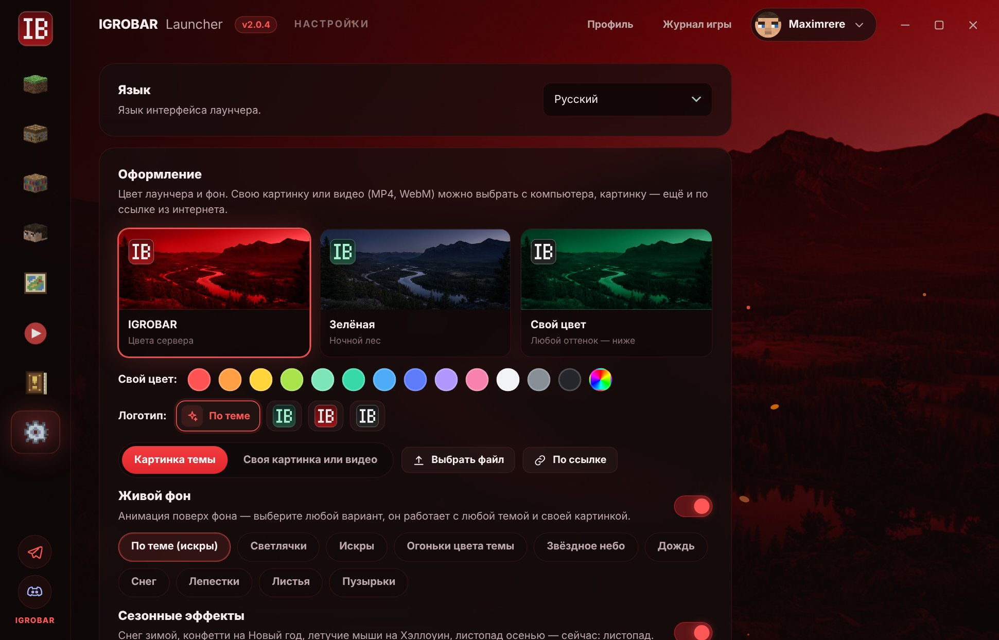
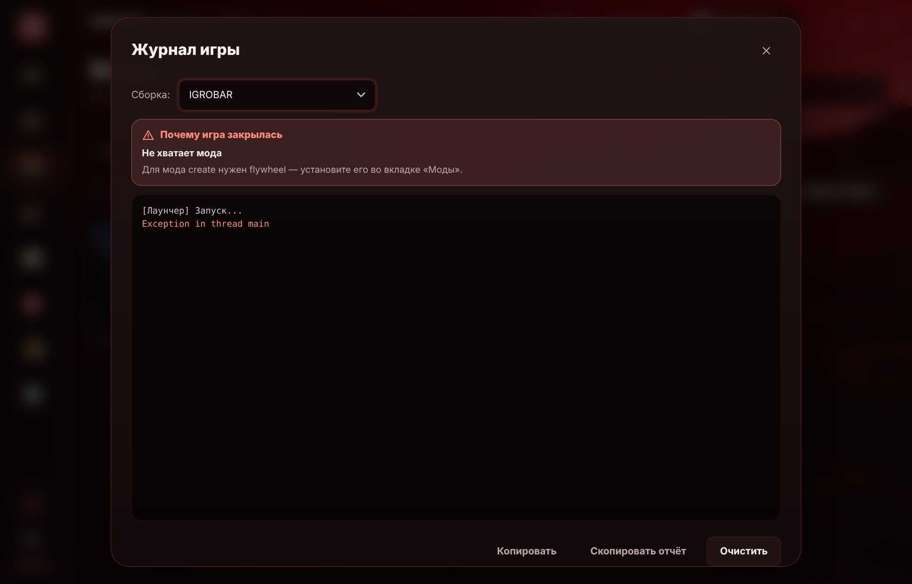

  

<h1 align="center">IGROBAR Launcher</h1>

  <b>Лаунчер Minecraft для сервера IGROBAR — и для любых своих сборок.</b> 
  Один клик до сервера, новости и онлайн на главной, моды с Modrinth, свой скин и плащ без лицензии.

  
  
  
  
  

  <a href="https://github.com/mdreval/ib-launcher/releases/latest"><b>⬇ Скачать последнюю версию</b></a>

  

---

## ⚡ Сервер IGROBAR в один клик

Нажал «Играть» — и ты на сервере. Лаунчер сам ставит нужную версию Minecraft и NeoForge,
скачивает модпак сервера и добавляет IGROBAR в «Сетевую игру».

- **Сразу на сервер** — после загрузки игра сама подключается к IGROBAR, без главного меню и списка серверов.
- **Модпак обновляется сам** — перед запуском и тихо в фоне, пока лаунчер открыт: к моменту игры всё уже скачано.
  Свои моды игрока не трогаются, выключенные остаются выключенными.
- **Всегда актуальная версия** — сервер переехал на новую версию Minecraft, и сборка у игроков перестроится сама.
- **Карта сервера** и **карта МТР** прямо в лаунчере.

## 📰 Новости, онлайн и друзья

- **Лента новостей** на главной — посты Telegram-канала сервера с картинками и закреплённые объявления.
- **Кто сейчас онлайн** — список игроков на сервере с головами их скинов, пинг и число игроков.
- **Друзья** — отметьте игрока ⭐, и лаунчер пришлёт **уведомление, когда друг зайдёт на сервер**
  (даже когда лаунчер свёрнут в трей).

## 🧱 Любые версии и сборки

- Все версии Minecraft Java: **релизы, снапшоты, бета и альфа**.
- Загрузчики **Forge, NeoForge, Fabric, Quilt** — версия подставляется с пометкой «рекомендуется».
- У каждой сборки **своя папка** с понятным именем — свои моды, миры, ресурспаки и настройки.
- Своя память, аргументы Java, размер окна и полный экран — для каждой сборки отдельно.
- **Импорт и экспорт сборок**: сборка сохраняется в один файл `.ibpack` (моды, конфиги, ресурспаки,
  шейдеры, настройки и по желанию миры) — отправьте другу, и он откроет её в своём лаунчере.
  Открываются и модпаки Modrinth `.mrpack`. Файл можно просто перетащить в окно.

## 🧩 Моды, миры и скриншоты

- Встроенный **каталог Modrinth** с поиском и категориями — установка в один клик, с зависимостями.
- **«Обновить все»** и **«Исправить»**, пометки «не хватает зависимостей» и «не для этой сборки».
- **Миры**: резервная копия в один клик, восстановление из копии, добавление мира из `.zip`, удаление в корзину.
- **Скриншоты**: галерея, просмотр со стрелками, копирование в буфер (сразу вставить в Discord или Telegram).

## 🎨 Скины и плащи — как в лицензии, но без неё

- **Свой скин виден в игре сразу** — в любой версии, в одиночной игре и на серверах, без модов.
- **Редактор скина**: кисть, ластик, заливка, пипетка, рисование на персонаже или на развёртке, два слоя, живой 3D-предпросмотр.
- **Каталог скинов** — MinecraftSkins.com, Ely.by и NameMC: нажал «Скачать» на сайте, и скин уже в лаунчере.
- **Плащи** — 5 готовых (IGROBAR, Ночной лес, Космос, Пламя, Лёд) или свой PNG; включаются и выключаются одним переключателем.

## 👤 Профиль игрока

Персонаж в 3D, сколько наиграно, количество запусков, самая долгая игра и время по каждой сборке.

## 🎵 Музыка

- Спокойный **встроенный эмбиент**, который сочиняется прямо в лаунчере, или **свои треки** (MP3, OGG, WAV…) по кругу.
- Плеер: пауза, предыдущий и следующий трек, **перемотка**, громкость. Во время игры музыка затихает сама.
- **Мини-плеер на главной** — для своей музыки и Spotify: пауза и переключение треков, не заходя в «Музыку».
- **Spotify**: обложка и трек из приложения Spotify на компьютере, пауза, переключение и перемотка прямо из лаунчера, запуск плейлиста по ссылке и своя громкость Spotify. Работает с бесплатным аккаунтом.

## 📜 Правила и ссылки

Правила сервера, ссылки на Telegram-канал, чат и Discord и инструкция, как попасть на сервер.
Всё обновляется с GitHub — без новой версии лаунчера.

## 🖌️ Оформление под себя

- Темы **IGROBAR** (красная), **зелёная** и **свой цвет** — любой оттенок, весь лаунчер перекрашивается под него.
- **Логотип на выбор**: по теме, зелёный, красный или серый — можно оставить красный логотип при любом своём цвете.
- **Своя картинка или видео на фоне** — с компьютера или по ссылке, с регулировкой затемнения.
- **Живой фон** на выбор: светлячки, искры, огоньки, звёздное небо, дождь, снег, лепестки, листья, пузырьки.
- **Сезонные эффекты**: снег зимой, конфетти на Новый год, летучие мыши на Хэллоуин, листопад осенью.
- Интерфейс на **русском, украинском и английском**.

## 🩺 Понятные причины вылета

Если игра закрылась с ошибкой, в «Журнале игры» написано **почему и что делать**: не хватило памяти,
не хватает мода, моды несовместимы, нужна другая Java, проблема с видеодрайвером и т. д.
Кнопка «Скопировать отчёт» — чтобы отправить его в Discord сервера.

## 💬 Discord

- Кнопки **Telegram** и **Discord** сервера в боковом меню.
- **Статус в Discord** — друзья видят «Играет на IGROBAR», версию игры и кнопки «Скачать лаунчер» и «Discord сервера».

## ☕ Java не нужна

Лаунчер сам скачивает правильную Java под каждую версию игры: Java 8 для 1.12.2 и старых версий,
Java 17 и 21 — для новых.

## 👥 Аккаунты

- **Офлайн-ник** — играть без лицензии.
- **Microsoft** — лицензия Minecraft.
- **Ely.by** — бесплатный аккаунт со скинами, которые видят все.
- Несколько профилей и быстрое переключение; токены хранятся зашифрованными.

## 🛡️ Надёжно

- **Докачка после обрыва** и повторные попытки — уже скачанное не теряется, установка не зависает.
- Проверка контрольных сумм модпака: моды меняются, только если всё скачалось целиком.
- Пока идёт игра, лаунчер прячется в трей и возвращается, когда игра закрыта.
- **Лаунчер обновляется сам** — новая версия ставится при перезапуске.

---

  Сделано для сервера <b>IGROBAR</b> · <a href="https://t.me/IGROBAR">Telegram</a> ·
  <a href="https://discord.gg/CxtzR2quvd">Discord</a> ·
  <a href="https://igrobar.dynmap.xyz/">Карта сервера</a> 
  Для разработчика: <a href="docs/MAINTAINING.md">docs/MAINTAINING.md</a> · Что нового: <a href="RELEASE_NOTES.md">RELEASE_NOTES.md</a>

