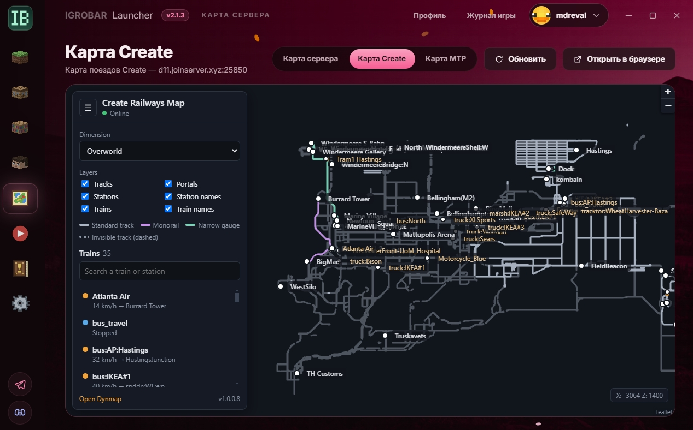

## IGROBAR Launcher 2.1.4

На сервере появилась карта железных дорог Create — теперь она есть прямо в лаунчере.

**🚂 Карта Create.** На вкладке «Карта сервера» между «Картой сервера» и «Картой МТР» появилась «Карта Create»: все пути, станции и поезда Create на сервере вживую — где какой поезд едет, с какой скоростью и до какой станции. Поезд или станцию можно найти поиском, а кнопка «Открыть в браузере» открывает карту отдельно.

**📐 Ровная шапка карт.** При переключении на «Карту Create» или «Карту МТР» кнопки больше не съезжают на вторую строку — переключатель карт, «Обновить» и «Открыть в браузере» всегда стоят в один ряд, а подпись под заголовком — в одну строку.

---

**Установка:** Windows — файл `.exe` ниже, Mac (M1 и новее) — `.dmg`. Установленный лаунчер на Windows обновится сам.
