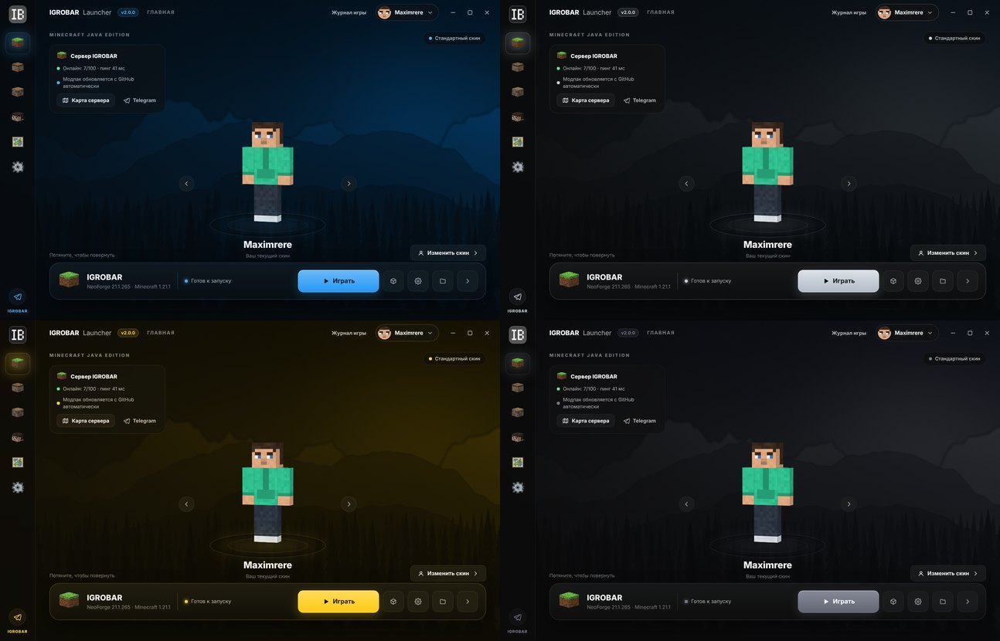
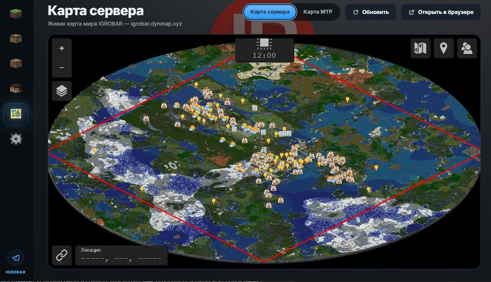

## Igrobar Launcher 2.0.3

### 🎨 Свой цвет лаунчера
- Новая тема **«Свой цвет»** в «Настройки → Оформление»: выберите готовый цвет или любой оттенок на цветовом круге.
- Весь лаунчер перекрашивается под выбранный цвет — кнопки, ползунки, рамки, подсветка и фон. Изменения видно сразу, пока вы выбираете цвет.
- Текст на кнопках сам становится чёрным или белым — как лучше читается на этом цвете.
- Логотип на своём цвете — серый, а на очень светлых цветах — чёрный.
- Своя картинка на фоне работает с любым цветом.

### 🗺️ Карта МТР
- На вкладке «Карта сервера» появился переключатель **«Карта МТР»** — карта поездов и линий сервера. Лаунчер запоминает, какую карту вы смотрели последней.

### 👕 Скины
- На сервере игроки с аккаунтами **Ely.by** теперь видят скины друг друга, а не стандартные или чужие лицензионные.
- Если ваш ник занят на Microsoft, в игре всё равно будет ваш скин — из лаунчера или с Ely.by.
- Аккаунт Ely.by: ваш скин с ely.by виден вам и в одиночной игре, и на серверах.

### 🔧 Исправлено
- Название вверху окна теперь пишется как **IGROBAR Launcher**.
- Подсказки у иконок бокового меню больше не прячутся под поиском и карточками.
- Окно выбора своего цвета больше не закрывается при движении ползунка.

---

**Установка:** скачайте `Igrobar-Launcher-Setup-2.0.3.exe` ниже (Windows) или `.dmg` для macOS.
Уже установленный лаунчер на Windows обновится сам при следующем запуске.
