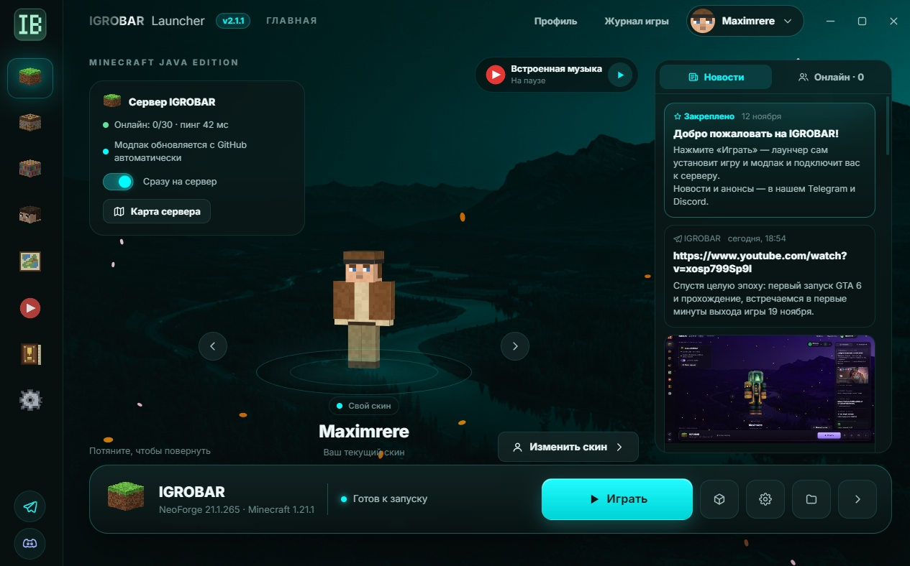
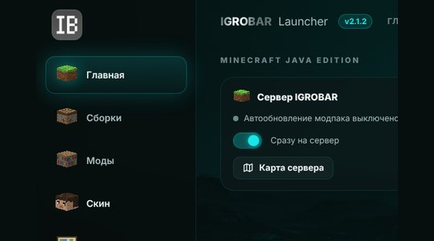
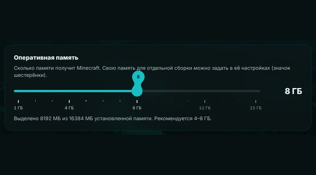
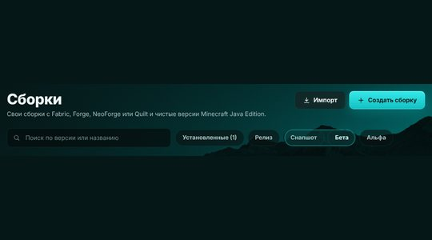
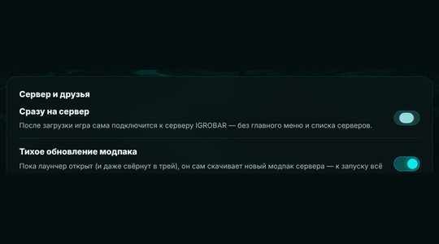
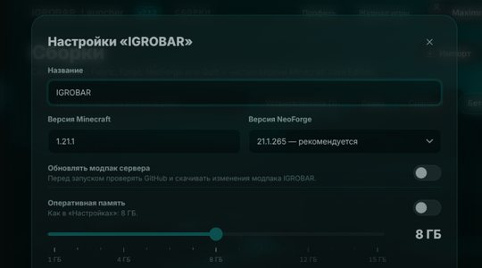
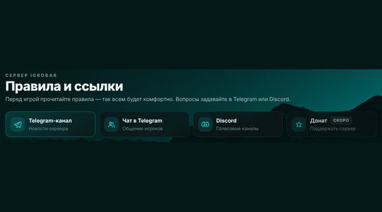

## IGROBAR Launcher 2.1.2

Обновление внешнего вида: лаунчер стал живее, всё двигается плавно и упруго.

**📂 Раскрывающееся меню.** Нажмите на логотип IB — боковое меню раскроется с названиями разделов, ещё раз — свернётся. Лаунчер запоминает, каким вы его оставили. В раскрытом меню кнопки Telegram и Discord встают в ряд.

**✨ Живой заголовок.** По слову IGROBAR в шапке пробегает металлический блик.

**🎚️ Желейные ползунки.** Память, громкость, перемотка и затемнение фона: бегунок тянется за мышью, а над ним всплывает капля со значением. У памяти появилась шкала в гигабайтах.

**🔘 Переключатели и вкладки.** Переключатели щёлкают с пружинкой. Подсветка вкладок («Новости / Онлайн», «Релиз / Снапшот / Бета / Альфа», «Установлено / Каталог» и других) переезжает к выбранной, а новости и список игроков мягко въезжают сбоку.

**🪟 Плавные окна.** Настройки сборки, аккаунты, журнал, скриншоты, подтверждения и всплывающие меню открываются и закрываются плавно — оттуда, где вы нажали.

**🧹 Мелочи.** В «Правилах и ссылках» подписи короче, а кнопки всегда в один ряд. Полоса прокрутки в окнах больше не вылезает за скруглённые углы. Под кнопками Telegram и Discord убрана подпись IGROBAR.

<!-- gallery: маленькие картинки только для GitHub, в Discord не уходят -->
<table>
<tr>
<td> Меню с названиями и блик в шапке</td>
<td> Желейный ползунок памяти</td>
<td> Подсветка тянется к вкладке</td>
</tr>
<tr>
<td> Переключатели с пружинкой</td>
<td> Окна открываются плавно</td>
<td> Ссылки в один ряд</td>
</tr>
</table>
<!-- /gallery -->

---

**Установка:** Windows — файл `.exe` ниже, Mac (M1 и новее) — `.dmg`. Установленный лаунчер на Windows обновится сам.
