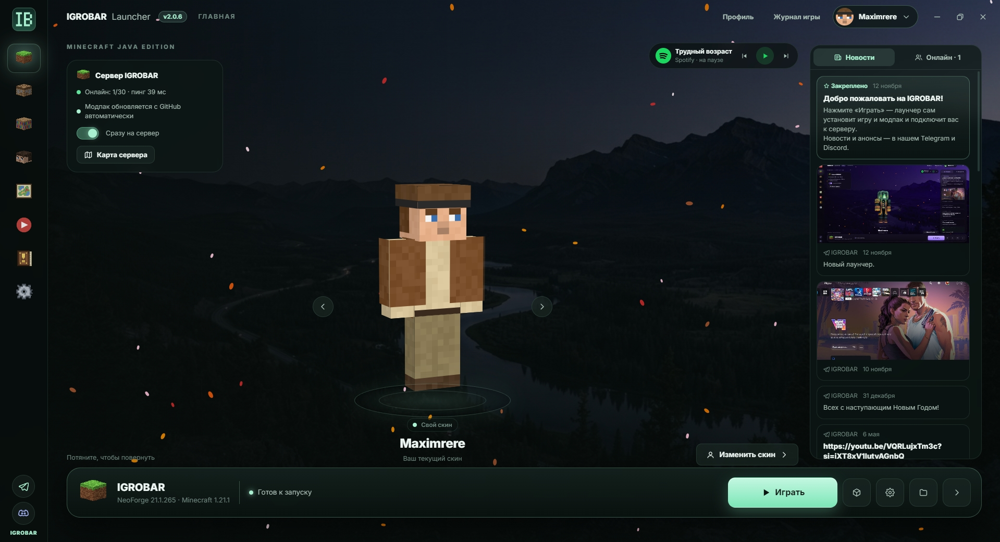

## IGROBAR Launcher 2.1.1

**✖️ Отмена установки.** Передумали ставить сборку — нажмите «Отмена»: она есть в «Сборках», в «Релизах» прямо в строке версии и на главной вместо кнопки «Играть». Всё, что успело скачаться, удаляется, а новая сборка пропадает из списка. Подготовку к запуску тоже можно отменить, пока игра не открылась.

**🧹 Меньше мусора.** При удалении сборки удаляются и файлы её версии Minecraft и загрузчика, если они больше не нужны другим сборкам.

**⚡ Моды открываются мгновенно.** Вкладки «Моды», «Ресурспаки» и «Шейдеры» больше не перечитывают все файлы и не ждут Modrinth: список показывается сразу, а обновления проверяются в фоне.

**🧠 Своя память для сборки.** Память, выставленная в настройках сборки (шестерёнка), теперь точно важнее общей из «Настроек». В «Журнале игры» видно, сколько памяти получила игра.

**✨ Мелочи.** Список сборок больше не моргает при запуске игры и установке. Из статистики в «Настройках» убраны версии лаунчера.

---

**Установка:** Windows — файл `.exe` ниже, Mac (M1 и новее) — `.dmg`. Установленный лаунчер на Windows обновится сам.
