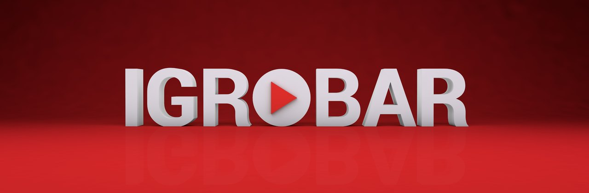
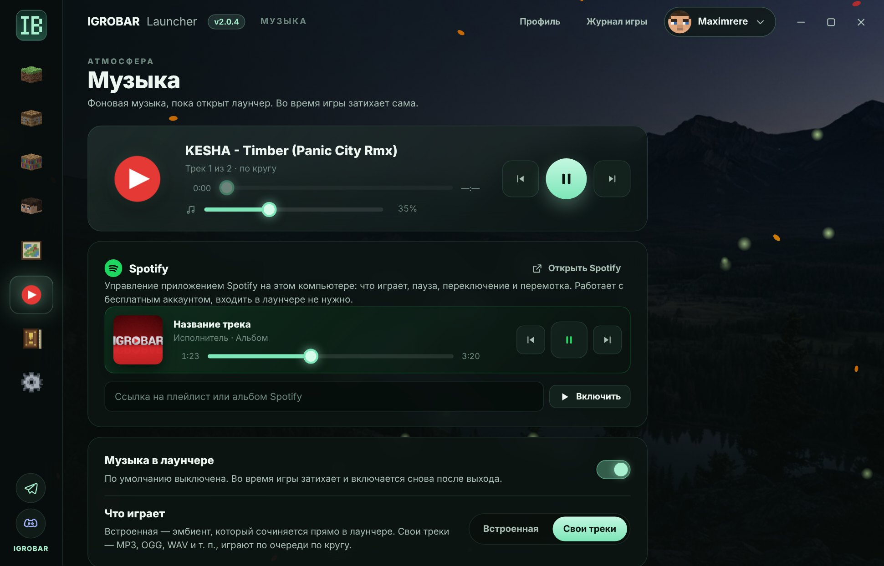
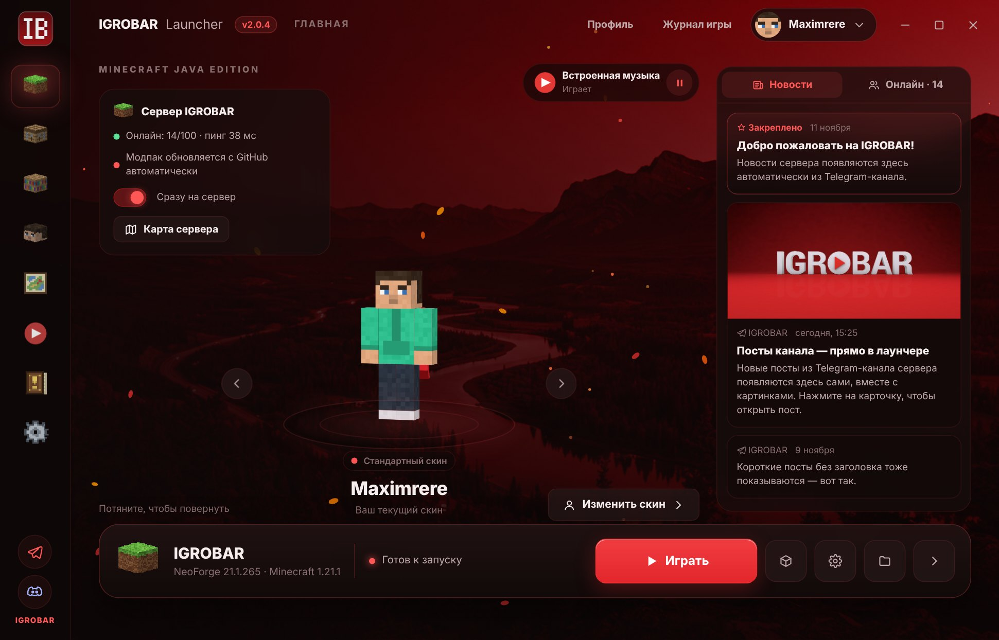
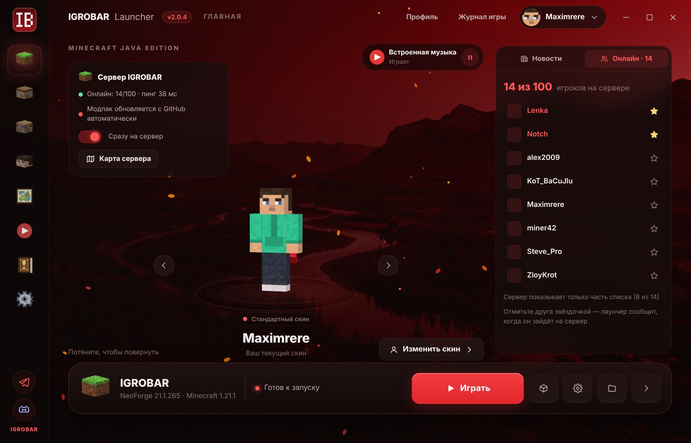
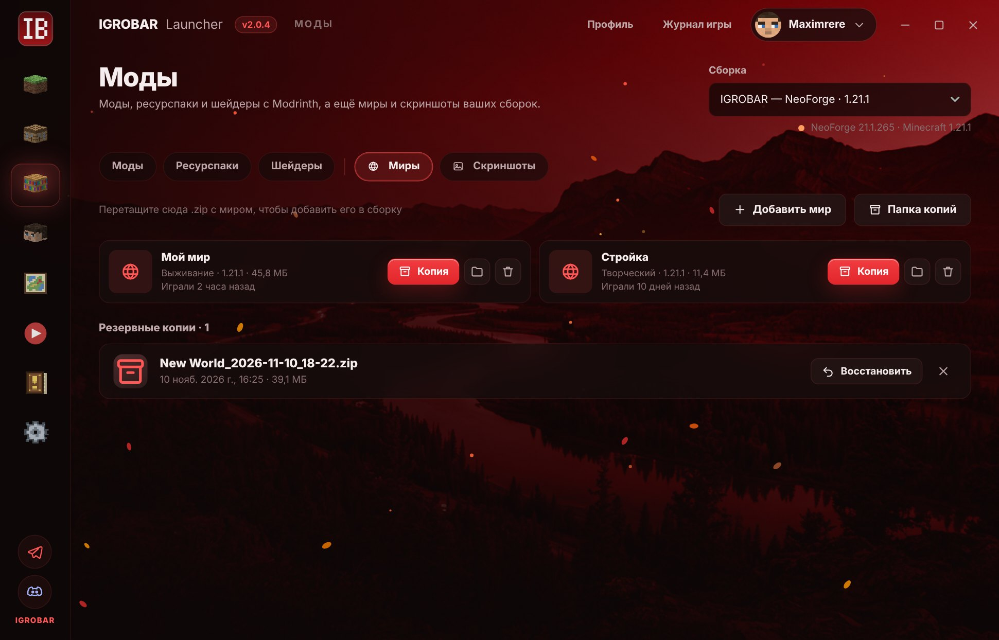
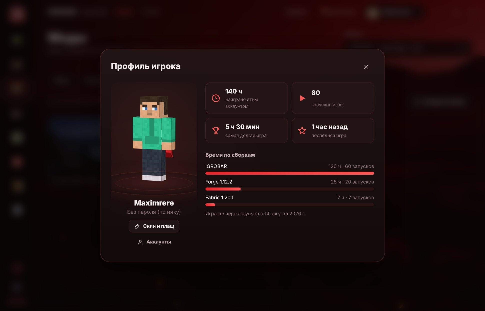
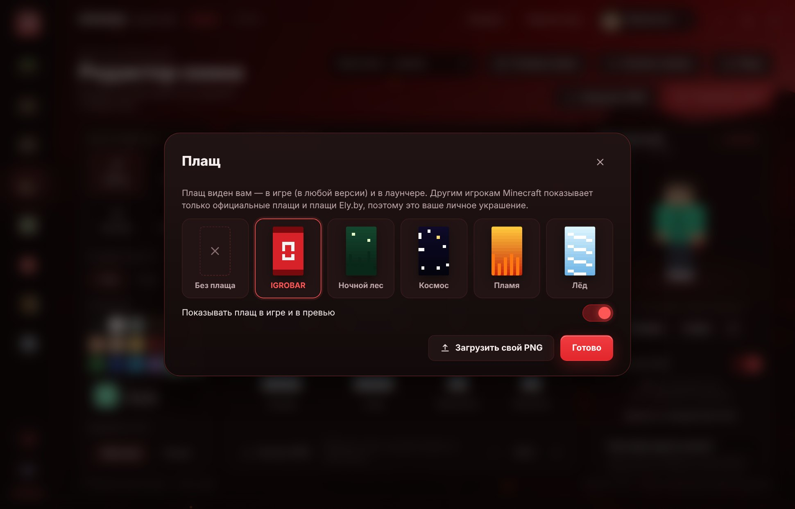
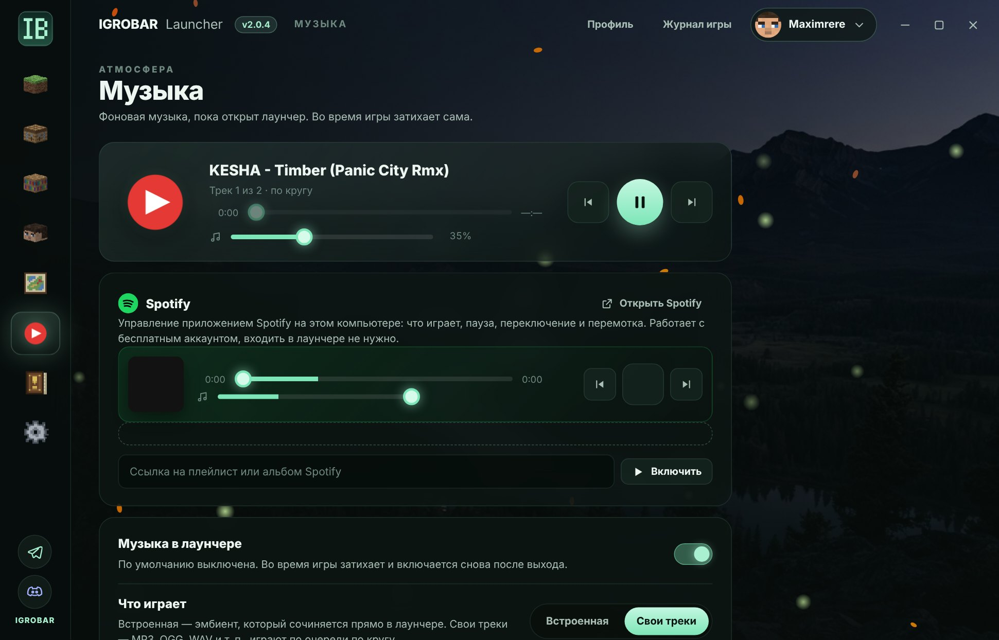
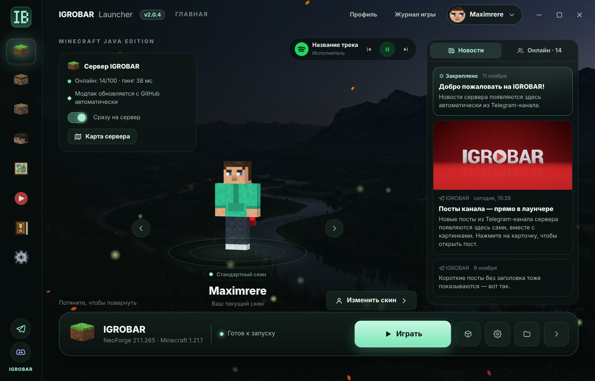
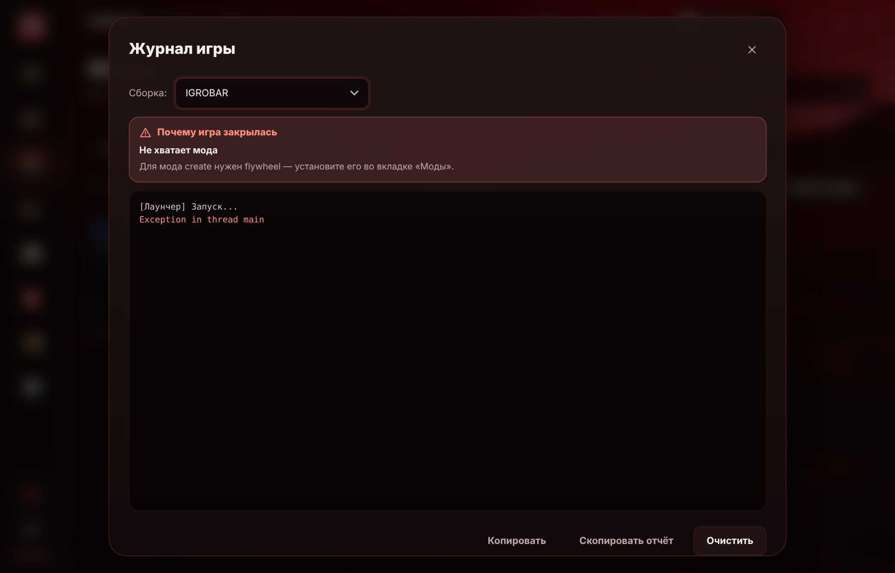

## IGROBAR Launcher 2.0.4

### 🟢 Spotify во вкладке «Музыка»
- Лаунчер показывает, что играет в приложении **Spotify** на компьютере: обложка, трек, исполнитель.
- Управление прямо из лаунчера: **пауза, предыдущий и следующий трек, перемотка**.
- Вставьте ссылку на плейлист или альбом — он сразу откроется в Spotify.
- **Громкость Spotify** — отдельный ползунок, не трогая общую громкость компьютера.
- Работает с бесплатным аккаунтом, входить в лаунчере не нужно. Когда включаете Spotify, музыка лаунчера ставится на паузу.

### ⏩ Перемотка своих треков
- У своих треков появилась полоса перемотки с текущим временем и длиной трека.

### 🎛 Мини-плеер на главной
- Когда играет музыка, на главной сверху появляется маленький плеер: пауза, предыдущий и следующий трек. Работает и со своей музыкой, и со **Spotify**. Нажмите на значок — откроется вкладка «Музыка».

### 🎨 Новый фон и логотип на выбор
- **Новый фон** — ночная долина с рекой и горами. В теме IGROBAR и «Свой цвет» он перекрашивается под цвет оформления.
- В «Оформлении» можно выбрать логотип: **по теме**, **зелёный**, **красный** или **серый** (на светлых цветах — чёрный). Например, оставить красный логотип при любом своём цвете.
- Красная тема теперь называется **IGROBAR** и стоит первой; вместо заставки с надписью — фон в красных тонах.
- Логотипы выбираются цветными кнопками, без подписей.

### 📰 Новости и онлайн на главной
- Справа на главной — **лента новостей** из Telegram-канала сервера, с картинками. Нажмите на пост, чтобы открыть его.
- Вкладка **«Онлайн»** — кто сейчас играет на сервере, с головами скинов.
- Отметьте игрока ⭐ — он попадёт в друзья, и лаунчер пришлёт **уведомление, когда друг зайдёт на сервер** (даже если лаунчер свёрнут в трей).

### 🚀 Сразу на сервер
- Переключатель **«Сразу на сервер»** на карточке сервера: после загрузки игра сама подключается к IGROBAR — без главного меню и списка серверов.
- **Модпак обновляется тихо**, пока лаунчер открыт: к моменту запуска всё уже скачано.

### 🌍 Миры и скриншоты
- На странице «Моды» — новые вкладки **«Миры»** и **«Скриншоты»**.
- Миры: резервная копия в один клик, восстановление из копии, добавление мира из .zip (можно просто перетащить), удаление в корзину.
- Скриншоты: просмотр со стрелками, копирование в буфер (сразу вставить в Discord или Telegram), открыть, показать в папке, удалить.

### 📦 Импорт и экспорт сборок
- **Экспорт**: сборка сохраняется в один файл `.ibpack` — моды, конфиги, ресурспаки, шейдеры, настройки игры (и миры, если хотите). Отправьте другу — он откроет её в своём лаунчере.
- **Импорт**: кнопка «Импорт» на странице «Сборки» или просто перетащите файл в окно. Открываются `.ibpack` и модпаки Modrinth `.mrpack`.

### 👤 Профиль игрока
- Кнопка **«Профиль»** вверху: ваш персонаж в 3D, сколько наиграно, количество запусков, самая долгая игра и время по каждой сборке.

### 🧣 Плащи
- На странице «Скин» — кнопка **«Плащ»**: 5 готовых плащей (IGROBAR, Ночной лес, Космос, Пламя, Лёд) или свой PNG.
- Плащ виден вам в игре и в превью. Его можно выключить одним переключателем.

### ✨ Живой фон
- **Живой фон** на выбор, с любой темой: светлячки, искры, огоньки цвета темы, звёздное небо, дождь, снег, лепестки, листья, пузырьки.
- **Сезонные эффекты**: снег зимой, конфетти на Новый год, летучие мыши на Хэллоуин, листопад осенью, лепестки весной.
- На фон можно поставить **своё видео** (MP4 или WebM).

### 🎵 Музыка
- Новая вкладка **«Музыка»** в меню слева: спокойный встроенный эмбиент или свои треки (MP3, OGG, WAV…), которые играют по кругу.
- Плеер: пауза, предыдущий и следующий трек, громкость, клик по треку — включить его. Пауза держится, пока вы сами не нажмёте ▶.
- Во время игры музыка затихает. По умолчанию выключена.

### 📜 Правила и ссылки
- Новая вкладка в меню слева: **правила сервера**, ссылки на Telegram-канал, чат в Telegram и Discord, и как попасть на сервер.

### 🩺 Понятные причины вылета
- Если игра закрылась с ошибкой, в «Журнале игры» сверху написано **почему** и что делать: не хватило памяти, не хватает мода, моды несовместимы, нужна другая Java, проблема с драйвером видеокарты и т. д.

### 🌐 Переводы
- Все новые разделы и надписи переведены на **украинский** и **английский**.

### 💬 Discord
- Кнопка **Discord-сервера IGROBAR** в боковом меню, рядом с Telegram.
- **Статус в Discord** («Играет на IGROBAR») — друзья увидят, что вы на сервере. Выключается в настройках.

---

**Установка:** скачайте `Igrobar-Launcher-Setup-2.0.4.exe` ниже (Windows) или `.dmg` для macOS.
Уже установленный лаунчер на Windows обновится сам при следующем запуске.
