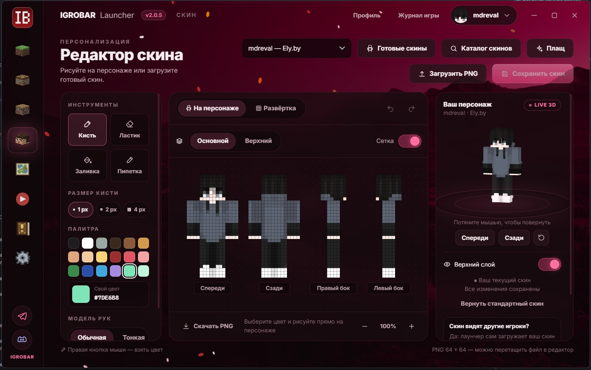

## IGROBAR Launcher 2.0.5

**👕 Скины теперь видят все.** Скин и плащ из лаунчера видны всем игрокам IGROBAR, а не только вам. Неважно, откуда скин: нарисован в редакторе, загружен файлом, взят из каталога, с Ely.by или из лицензии.

Лаунчер сам отправляет скин на сервер скинов IGROBAR при сохранении и перед запуском игры. Ничего настраивать и регистрировать не нужно.

> Скины друг друга видят игроки, у которых стоит лаунчер версии 2.0.5 или новее — обновитесь вместе с друзьями.

---

**Установка:** Windows — файл `.exe` ниже, Mac (M1 и новее) — `.dmg`. Установленный лаунчер на Windows обновится сам.
